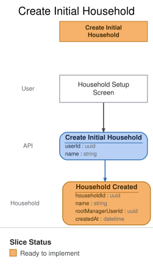

# Slice: Create Initial Household

## Intent

Create the new user’s first household with a user-provided name. The authenticated user becomes the
household’s root manager, and subsequent budget setup is owned by that household.

## Application API contract

- `POST /v1/households` accepts `{ "name": string }` for the authenticated user.
- The application derives the root manager from the session; the client cannot provide an owner or
  household ID.
- A successful response returns the created household and manager role. Duplicate initial creation
  is rejected or resolved to the existing household according to the command invariants.
- The route maps to `Create Initial Household`; `Household Created` is the durable domain result.

## Domain behavior

### Command

`Create Initial Household` accepts the authenticated principal and a non-empty household name.
Identity and household authorization are resolved at the application boundary; the command does not
accept an arbitrary owner or household scope from the client.

### Event

`Household Created` records the household identity, display name, and root-manager ownership.

## Scenarios

### Create the initial household

Given an authenticated user with no household
When the user submits a valid household name
Then Nemeo creates one household owned by that user
And the user is assigned the root manager role
And Nemeo records `Household Created`

### Household name is required

Given an authenticated user with no household
When the user submits an empty or invalid household name
Then the household is not created
And the user receives a validation error

### User already belongs to a household

Given an authenticated user who already belongs to a household
When the user submits initial household setup
Then Nemeo does not create a second household
And the user is directed to the existing household

### Unauthenticated setup attempt

Given a request without a valid authenticated principal
When the request attempts to create an initial household
Then Nemeo rejects the command
And no household is created

## Invariants

- A user belongs to exactly one household in MVP.
- The initial household has exactly one root manager lifecycle owner.
- The household name is present and valid before `Household Created` is recorded.
- The client cannot choose another user as the root manager.
- Repeating the command cannot create a second household for the same user.

## Open questions

None for the MVP slice.

## Verification notes

- Cover successful creation, invalid names, duplicate submission, an existing household, and an
  unauthenticated request with PostgreSQL-backed integration tests at the application boundary.
- Verify that the created household is immediately available to the next budget-setup slice and that
  the root-manager authorization is resolved consistently for HTTP, MCP, worker, and scheduled paths.
