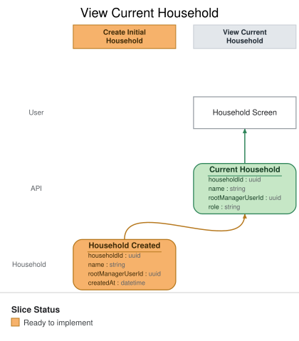

# Slice: View Current Household

## Intent

Return the authenticated user’s current household when one exists. This is the resource read used
after authentication and during onboarding; absence of a household tells the application to show
initial household setup.

## Trigger & Actor

The authenticated user or an application client requests the current household.

## Application API contract

- `GET /v1/household` returns the current household for the authenticated user.
- A successful response includes the household ID, name, and the user’s role.
- If the authenticated user has no household, the route returns `404 household_not_found`; this is
  the normal onboarding state, not a domain event.
- An unauthenticated request is rejected or redirected to Google authentication without revealing
  household state.

## Command / Input
<!-- GENERATED:em-slice-command:start — generated from the model by `em slice sync`; do not hand-edit -->
_This slice has no command in the model._
<!-- GENERATED:em-slice-command:end -->

## Trigger

**Triggered by:** authenticated user or API client requesting the current household.

## Event(s) Emitted
<!-- GENERATED:em-slice-event:start — generated from the model by `em slice sync`; do not hand-edit -->
_This slice has no event in the model._
<!-- GENERATED:em-slice-event:end -->

## Read Model / View
<!-- GENERATED:em-slice-view:start — generated from the model by `em slice sync`; do not hand-edit -->
- **View:** `Current Household` built from events: "Household Created"

| Field | Type | Source / Notes |
|-------|------|----------------|
| householdId | uuid | from event `Household Created` |
| name | string | from event `Household Created` |
| rootManagerUserId | uuid | from event `Household Created` |
| role | string | Derived |
<!-- GENERATED:em-slice-view:end -->

- **Consumed by:** household setup, dashboard, and other authenticated household experiences.
- **Freshness / consistency expectation:** read-after-write for the creating user; current
  membership and role must be authorization-consistent.

## Invariants / Business Rules
<!-- GENERATED:em-slice-invariants:start — generated from the model by `em slice sync`; do not hand-edit -->
_No invariants declared in the model._
<!-- GENERATED:em-slice-invariants:end -->

- The view is scoped to the authenticated user and never accepts a client-supplied user ID.
- A user belongs to at most one household in MVP.
- A missing household is represented by the API resource-not-found response; it does not append an
  event or create setup state.

## Scenarios (Given / When / Then)

### Scenario: Existing household is returned

- **Given:**
  - an authenticated user belongs to a household
- **When:**
  - the user requests `GET /v1/household`
- **Then:**
  - the current household and the user’s role are returned
  - no domain event is recorded

### Scenario: New user is directed to setup

- **Given:**
  - an authenticated user does not belong to a household
- **When:**
  - the user requests `GET /v1/household`
- **Then:**
  - the API returns `404 household_not_found`
  - no household state or domain event is created
  - the application may present initial household setup

### Scenario: Household data is not disclosed across users

- **Given:**
  - an authenticated user belongs to household A
- **When:**
  - the user requests the current household
- **Then:**
  - only household A is considered
  - the response contains no other household’s data

## Alternate & Error Flows

- A missing or expired session is rejected or redirected to Google authentication without disclosing
  household membership.
- A projection or persistence failure returns a recoverable error and never converts an unknown
  failure into `404 household_not_found`.

## Non-Functional Requirements

- **Security / authz:** resolve the household from the authenticated principal and enforce the same
  household authorization rules used by HTTP, MCP, worker, and scheduled entry points.
- **PII & compliance:** return only the household fields needed by the caller; do not expose provider
  credentials or unrelated member data.
- **Performance / SLA:** ordinary authenticated read latency; no external provider call required.

## Dependencies & Read Models Affected

- **Upstream events this slice relies on:** `Household Created`.
- **Downstream read models / slices affected:** household setup, dashboard, budgets, and transactions
  use the current household identity as their scope.

## Open Questions

None for MVP.
