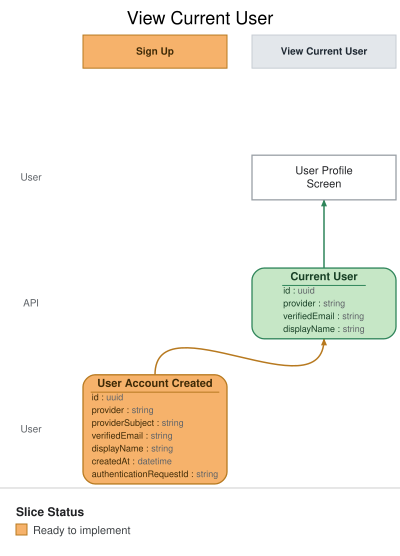

# Slice: View Current User

<!-- GENERATED:em-slice-story:start — generated from the model by `em slice sync`; do not hand-edit -->
Step 3 of 9 · after [Authenticate](./authenticate.md) · before [Create Initial Household](./create-initial-household.md) · State View
<!-- GENERATED:em-slice-story:end -->

## Intent

Return the authenticated Nemeo user's profile and provider metadata needed by the application. This
is the authenticated-user resource used after Google sign-in and during onboarding.

## Trigger & Actor

The authenticated user requests their own profile.

## Command / Input
<!-- GENERATED:em-slice-command:start — generated from the model by `em slice sync`; do not hand-edit -->
_This slice has no command in the model._
<!-- GENERATED:em-slice-command:end -->

## Event(s) Emitted
<!-- GENERATED:em-slice-event:start — generated from the model by `em slice sync`; do not hand-edit -->
_This slice has no event in the model._
<!-- GENERATED:em-slice-event:end -->

## Application API contract

- `GET /v1/users/me` returns the authenticated user's profile.
- The user ID comes from the authenticated session; the client cannot supply another user ID.
- The response excludes `providerSubject`, provider tokens, session secrets, and other identity
  adapter credentials.

## Read Model / View
<!-- GENERATED:em-slice-view:start — generated from the model by `em slice sync`; do not hand-edit -->
- **View:** `Current User` built from events: "User Account Created", "User Authenticated"

| Field | Type | Source / Notes |
|-------|------|----------------|
| id | uuid | from event `User Account Created` |
| provider | string | from event `User Account Created` |
| verifiedEmail | string | from event `User Account Created` |
| displayName | string | from event `User Account Created` |
<!-- GENERATED:em-slice-view:end -->

- **Consumed by:** the authenticated user profile API and onboarding flow.
- **Freshness / consistency expectation:** read-after-write for the creating user.

## Invariants / Business Rules
<!-- GENERATED:em-slice-invariants:start — generated from the model by `em slice sync`; do not hand-edit -->
_No invariants declared in the model._
<!-- GENERATED:em-slice-invariants:end -->

- The session principal determines which user is returned.
- A request cannot read another user's profile through this view.
- Provider subject identifiers and credentials are not returned by the HTTP resource.

## Scenarios (Given / When / Then)

### Scenario: Authenticated user reads their profile

- **Given:**
  - a valid authenticated session for user A
- **When:**
  - user A requests `GET /v1/users/me`
- **Then:**
  - the profile for user A is returned
  - no domain event is recorded

### Scenario: Unauthenticated request is rejected

- **Given:**
  - no valid authenticated session
- **When:**
  - the client requests `GET /v1/users/me`
- **Then:**
  - the request is rejected without disclosing user data

## Alternate & Error Flows

- A missing or expired session returns the standard unauthenticated response.
- A projection or persistence failure returns a recoverable server error and never reveals another
  user's profile.

## Non-Functional Requirements

- **Security / authz:** resolve the profile only from the authenticated principal.
- **PII & compliance:** return only the profile fields needed by the caller; never return provider
  credentials or session secrets.
- **Performance / SLA:** ordinary authenticated read latency; no provider call required.

## Dependencies & Read Models Affected

- **Upstream events this slice relies on:** `User Account Created`.
- **Downstream read models / slices affected:** onboarding and household setup use the authenticated
  user identity.

## Open Questions

None for MVP.
