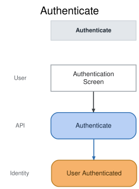

# Slice: Authenticate

## Intent

Authenticate a user whose external provider subject is already linked to a Nemeo profile. Google is
the only enabled provider for MVP. This is the alternative path from the same authentication screen
used for signup; it is not a second step after signup.

## UI / interaction design

- Screen: [Authentication](../../design/wireframes/authentication.html)
- MVP copy: **Continue with Google**.
- The screen does not ask the user to choose sign-up versus sign-in; the provider result determines
  which command is processed.

## Trigger and actor

The user selects the configured provider action and completes its OIDC flow. For MVP that action is
**Continue with Google**. Nemeo receives a validated provider result through the identity adapter.

## Domain behavior

### Command

`Authenticate` accepts a normalized, validated provider identity result. Provider tokens,
authorization codes, client secrets, and raw provider payloads remain in the identity adapter.

The command resolves an existing identity by the stable `(provider, providerSubject)` pair. It does
not create profiles, link identities, or merge users.

### Event

`User Authenticated` records the successful resolution of an existing Nemeo identity. The
application establishes a revocable opaque browser session after the event is durably recorded;
the session secret is not part of the event stream.

## Command fields

| Field | Rule |
| --- | --- |
| `provider` | `google` for MVP; explicit for future providers |
| `providerSubject` | Required stable Google subject; used for lookup and never inferred from email |
| `authenticationRequestId` | Required correlation/idempotency identifier |

## Event facts

`User Authenticated` contains the resolved `userId`, provider, authentication timestamp, and
correlation identifier. It contains no browser session token, provider credential, or raw provider
payload.

## Scenarios

### Existing Google identity is authenticated

Given a valid verified Google identity whose `(provider, providerSubject)` pair is linked
When the user completes **Continue with Google**
Then Nemeo records `User Authenticated`
And Nemeo establishes a new revocable secure browser session
And the user proceeds to the appropriate household experience

### Unknown Google subject does not create an account

Given a valid Google identity whose subject is not linked
When the user completes the authentication path
Then Nemeo does not create a profile
And the user is directed to the signup path
And no authenticated session is established by this slice

### Matching email does not authorize access

Given an unlinked Google subject whose email matches an existing profile
When the user attempts authentication
Then Nemeo does not authenticate the unlinked identity
And Nemeo does not merge or link profiles
And the user receives guidance to use the already-linked Google identity

### Invalid, cancelled, or failed provider flow

Given the configured provider cannot complete or validate the OIDC flow
When the authentication callback is handled
Then no `User Authenticated` event is recorded
And no browser session is established
And the user receives a recoverable error

### Replayed authentication callback

Given the same valid authentication request is delivered more than once
When Nemeo processes the replay
Then the request is handled idempotently
And Nemeo does not create a profile or broaden authorization

## Invariants

- **AUTH-001:** Authentication requires an existing exact `(provider, providerSubject)` mapping.
- **AUTH-002:** Matching email addresses are not sufficient evidence for identity linking or access.
- **AUTH-003:** Authentication never creates a profile or household.
- **AUTH-004:** Failed, cancelled, invalid, or rejected authentication emits no event and establishes no session.
- **AUTH-005:** No provider credential, raw provider payload, or session secret enters the event stream.
- **AUTH-006:** The resulting session resolves to the same user principal used by HTTP, MCP, worker, and scheduled entry points.

## Alternate and error flows

- Provider-subject lookup failure: return a recoverable error without creating or modifying identity data.
- Database/event write failure: do not issue a browser session; retry only through an idempotent request path.
- Session issuance failure: surface a recoverable error and allow safe retry without changing identity mappings.

## Read models and downstream effects

`User Authenticated` feeds `Household Setup Status`, which makes the initial household setup path
available for a user who has not yet created a household.

## Open questions

None for MVP.

## Verification notes

- Use provider contract fixtures; never use real provider credentials in automated tests.
- Cover existing identity, unknown subject, email collision, invalid/cancelled callbacks, replay,
  event-write failure, and session-issuance failure.
- PostgreSQL-backed integration tests should verify exact-subject lookup, idempotency, and absence of
  secrets in the event payload.
- A critical-path browser test should verify that returning users go from Google completion to their
  household experience without a second authentication screen.
